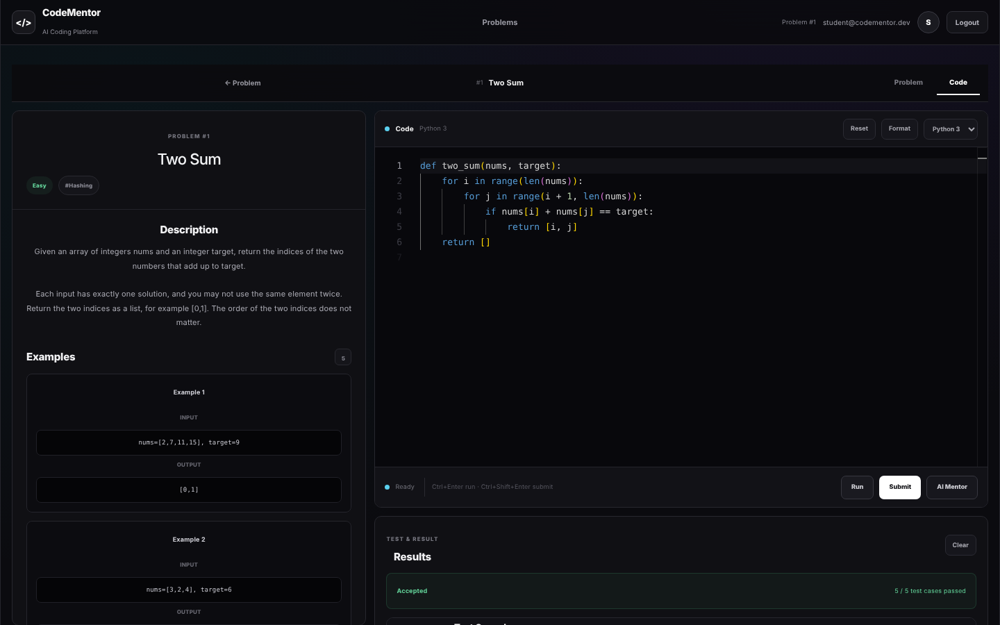
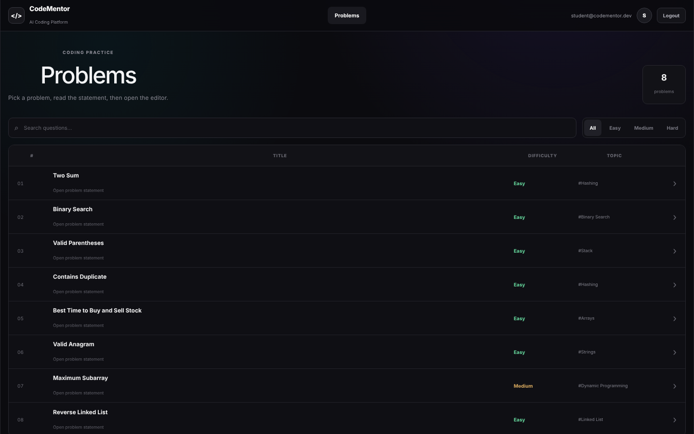
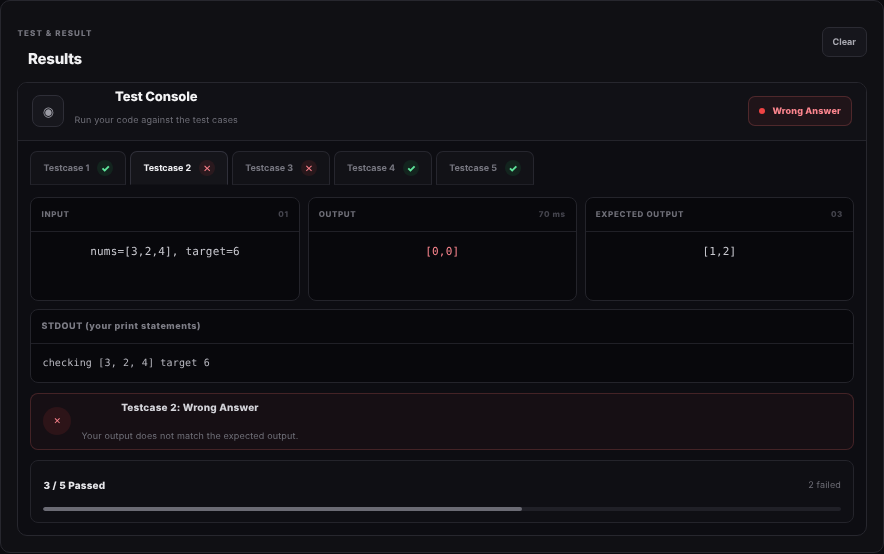
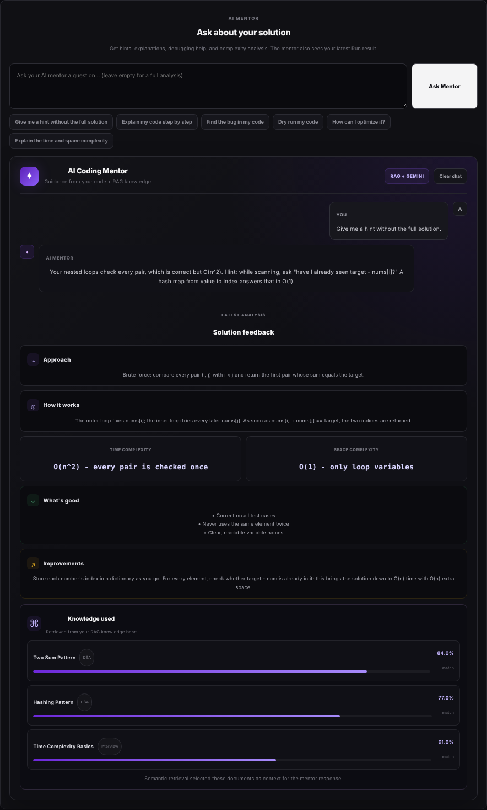

# CodeMentor — AI Coding Practice Platform

[](https://github.com/Akshay031-eng/CodeMentor/actions/workflows/ci.yml)

A LeetCode-style practice platform with a **multi-language code judge** (Python, Java, C++, C) and a **RAG-powered AI mentor** that reviews your actual code, explains failing test cases and gives hints without spoiling the answer.

**Live demo:** https://code-mentor-hazel.vercel.app — click **"Try the demo account"**, no sign-up needed.
<sub>The backend runs on a free plan and sleeps when idle; the first request can take up to a minute.</sub>



## Features

- **Code judge for 4 languages** — compiles once, runs every test case in parallel, and returns LeetCode-style verdicts: *Accepted, Wrong Answer, Compilation Error, Runtime Error, Time Limit Exceeded*.
- **Real debugging feedback** — per-test input / output / expected, your `print` output shown separately, compiler errors mapped to *your* line numbers, runtime per test.
- **AI mentor (RAG)** — retrieves relevant DSA notes from a pgvector knowledge base and sends Gemini the problem, your code, your last run's failing test and the chat history. Answers hints, bug hunts, dry runs and complexity questions.
- **Async submissions** — Redis + RQ worker queue with live status polling (Queued → Running → verdict), with automatic in-process fallback when Redis is down.
- **Monaco editor** (VS Code's editor) with per-language drafts saved locally, Ctrl/⌘+Enter to run, and submission history you can reload.
- **Auth & data** on Supabase (email login, Row Level Security), one-click demo account.

| Problem list | Debugging a wrong answer | AI mentor |
|---|---|---|
|  |  |  |

## Tech stack

| Layer | Technology |
|---|---|
| Frontend | React 19, Vite, Monaco Editor, Supabase JS |
| Backend | Python, FastAPI, Pydantic |
| Judge | Generated harnesses for Python / Java / C++ / C, subprocess sandboxing |
| Queue | Redis + RQ (optional) |
| AI | Gemini via LangChain, RAG over Supabase pgvector (`gemini-embedding-001`) |
| Data & auth | Supabase (Postgres, Auth, RLS) |
| DevOps | Docker, GitHub Actions CI, Render (API), Vercel (frontend) |

## Architecture

```
 Browser (Vercel)                    API (Render, Docker)                     Supabase
┌──────────────────────┐  HTTPS   ┌───────────────────────────────┐       ┌─────────────────┐
│ React + Monaco       │ ───────▶ │ FastAPI                       │ ◀───▶ │ Postgres + RLS  │
│ Supabase Auth (JWT)  │          │  /run      → judge (sync)     │       │ problems        │
│                      │          │  /submit   → queue / inline   │       │ test_cases      │
│                      │          │  /mentor   → RAG + Gemini     │       │ submissions     │
└──────────┬───────────┘          │                               │       │ knowledge (vec) │
           │ login                │ code_runner: compile once,    │       └─────────────────┘
           └────────────────────▶ │ run tests in parallel         │──▶ Gemini API
                                  └───────────────────────────────┘
```

## How the judge works

1. **One spec per problem.** `PROBLEMS` in `code_runner.py` describes parameter types, function names and return type. The Python, Java, C++ and C harnesses are generated from it, so adding a problem is one entry instead of four hand-written wrappers.
2. **Compile once, run many.** C, C++ and Java are compiled a single time; each test case is then fed to the same binary over **stdin** (strings are hex-encoded, so any character survives). ~5× faster for Java than recompiling per test.
3. **Clean output.** The harness prints a marker right before the function's return value, so the student's debug prints are shown as STDOUT and never break the comparison.
4. **Readable errors.** `#line` directives make compiler errors point at the student's own line numbers; harness frames are stripped from Python tracebacks; a wrong signature gets a hint with the expected one.
5. **Hardening.** User code runs in a throw-away temp directory with a minimal environment (no API keys), a wall-clock timeout, and on Linux CPU / memory / output-size limits. In the Docker image every compile and run happens as a separate unprivileged `sandbox` user with its limits (including a process cap against fork bombs) applied *before* the program starts, so student code cannot kill the API, read its secrets through `/proc` or modify the app; the API process is also marked non-dumpable.

## Run locally

Requirements: Python 3.10+, Node 20+, JDK 17+, gcc/g++ (MinGW on Windows). Redis is optional.

```bash
# 1. Database: in the Supabase SQL editor run Backend/supabase_schema.sql,
#    then Backend/supabase_seed.sql (8 problems + 36 test cases).

# 2. Backend
cd Backend
python -m venv venv
venv\Scripts\activate          # macOS/Linux: source venv/bin/activate
pip install -r requirements.txt
copy .env.example .env         # macOS/Linux: cp .env.example .env  -> fill in the keys
python -m rag.ingest_knowledge # load the AI mentor's knowledge base
uvicorn main:app --reload --port 8002

# 3. Frontend (second terminal)
cd Frontend
npm install
copy .env.example .env         # fill in the Supabase URL + publishable key
npm run dev                    # http://localhost:5173
```

Optional queue: start Redis, set `SUBMISSION_MODE=queue` and run `python worker.py` (works on Windows too).

## Tests

```bash
cd Backend && python -m pytest tests -q      # 73 tests (sandbox ones need root + TEST_SANDBOX_USER)
cd Frontend && npm run lint && npm run build
```

The backend suite runs a reference solution for **every problem in every language**, checks compile/runtime/timeout handling and secret isolation, and tests the API end-to-end against an in-memory Supabase fake — including the real Redis queue + worker when Redis is available. GitHub Actions runs everything on each push.

## Deployment

Step-by-step guide: **[DEPLOY.md](DEPLOY.md)** (Render for the API, Vercel for the frontend — both free).

## Project structure

```
Backend/
  main.py              FastAPI routes, auth, rate limiting
  code_runner.py       judge: harness generation, compile/run, comparison
  judge.py             evaluation + verdicts (shared by API and worker)
  worker.py            RQ worker for queued submissions
  rag/                 retrieval + Gemini mentor, knowledge base ingestion
  supabase_schema.sql  tables, vector search function, RLS
  supabase_seed.sql    sample problems and test cases
  tests/               pytest suite
  Dockerfile
Frontend/
  src/components/      ProblemList, ProblemDetails, CodeEditor, TestConsole, AIMentor
  src/services/api.js  API client
  src/lib/             Supabase client, drafts, starter code
```

## Roadmap

- Block network access for student code (gVisor / Firecracker / nsjail) before opening to a large public audience
- Hidden test cases and per-problem time limits
- More problems and a problem editor for admins
- Distributed rate limiting with Redis when running several API instances
